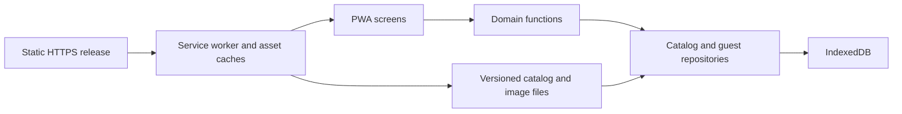

# Architecture

Proposed implementation for the constraints in [[00-SOURCE-OF-TRUTH]].

## Boundaries and ownership

- **Screens** own input, navigation and feedback. Recipe search, ranking, scaling and grocery merging are deterministic domain functions that accept data as input.
- **Catalog repository** reads a verified release snapshot. Keep stable IDs, immutable release artifacts and a deterministic local search index. Load images lazily for rendering after setup downloads them. Measure whether indexing in memory is sufficient before adding a worker.
- **Guest repository** owns plans, templates, custom recipes, grocery progress, cooking sessions and preferences. Commit related operations atomically. Keep local data separate from disposable catalog data so reseeding cannot erase guest records.
- **Offline delivery** owns shell caching, asset downloads, readiness verification and release lifecycle. Cache Storage holds shell and image responses. IndexedDB holds guest data and the active catalog snapshot. One version pointer activates a completed catalog import.
- **Content build** validates source records and rights, builds indexes and emits a manifest with versions, hashes and sizes. Run this in the build pipeline. Production requests resolve to same-origin static files.

## Candidate stack

| Candidate | Evaluate |
|---|---|
| React + Vite + TypeScript | Accessible views, static build, predictable bundle sizes and strict boundary types. |
| Dexie + IndexedDB | Transaction behavior, blocked upgrades across tabs, quota errors and supported mobile browsers. |
| Workbox | Shell revisioning, route fallback and compatibility with staged catalog activation. Inspect emitted precache entries. |
| Capacitor later | Reuse domain code and UI where practical. Validate native packaging, asset loading and native persistence independently. |

Keep file formats and domain rules independent of any UI or persistence library. Start with the smallest working storage boundary and add a platform adapter when a native prototype needs it.

See [[DATA-MODELS]], [[OFFLINE-STRATEGY]] and [[DECISIONS]].
